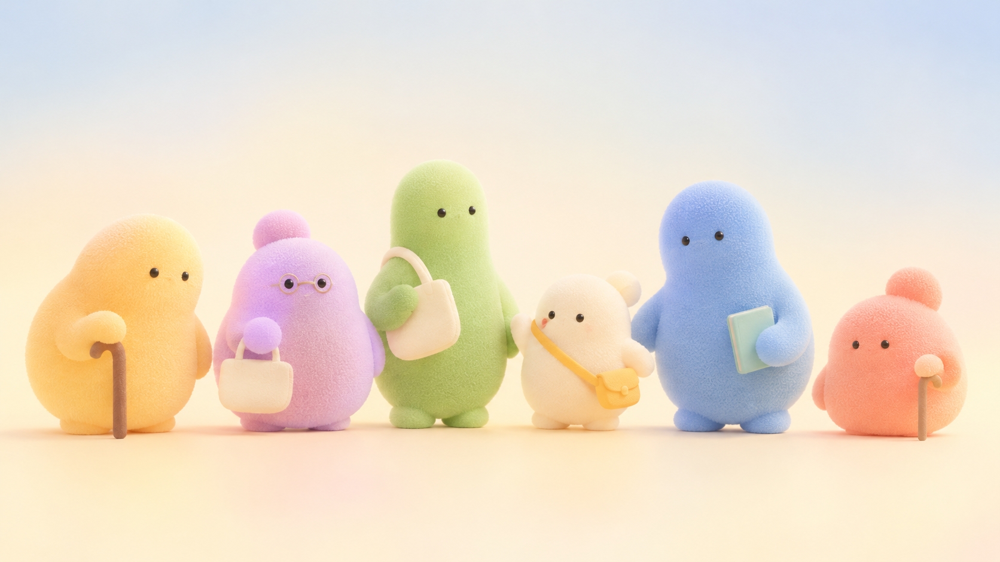
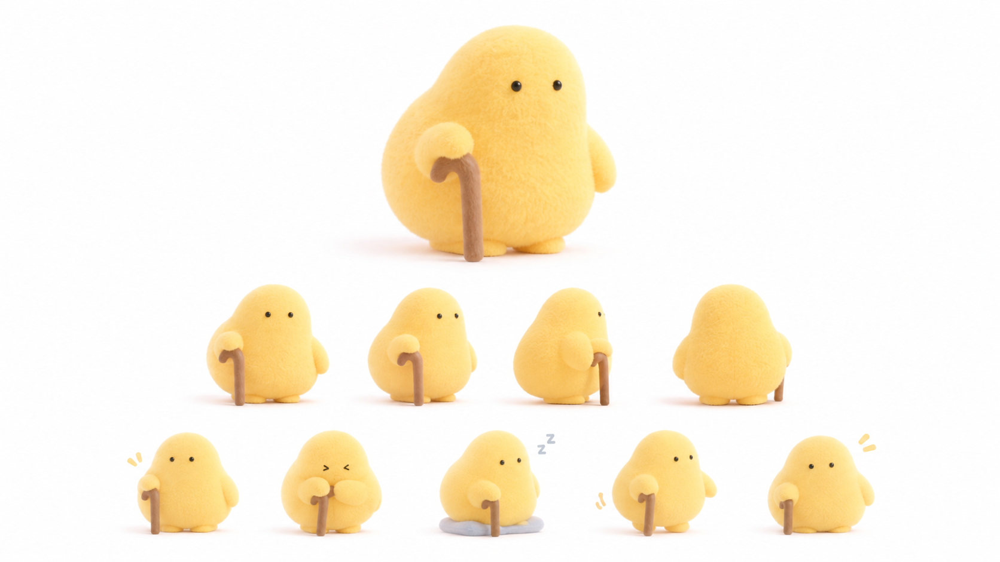

# ECHO NOD — 프로젝트 브리프

## [프로젝트 설명]

ECHO NOD는 가족이 같은 차에서 서로의 노래를 듣다가 말이 트이고 서로를 알게 되는 서비스야.

- 대상: 같은 차를 타는 가족. 운전자와 탑승자 모두.
- 문제: 가족은 차 안에서 오래 같이 있지만, 각자 폰을 보고 각자 이어폰으로 들어서 서로의 취향을 모른다.
- 방법: 차에 타면 가족 각자의 노래가 차례로 나오고, 누구의 노래인지와 말을 꺼낼 한 줄이 화면에 뜬다. 음악이 대화의 물꼬가 된다.
- 목표: 유대감. 상대를 알아가고, 내가 인정받았다고 느낄 때 생긴다고 본다.

### 이름의 뜻

- ECHO(메아리): 보낸 노래가 시간이 지나 돌아온다. 가족 차에 넣어둔 곡이 그 사람이 다음에 탈 때 흘러나온다.
- NOD(끄덕임): 받은 노래가 좋으면 끄덕여서 응답한다. 서로 끄덕인 곡은 "둘의 노래"로 쌓인다.

### 화면은 세 종류야

- 차 안 디스플레이: 지금 누구의 노래인지를 그 사람의 색으로 보여 준다. 조용하고 거의 움직이지 않는다.
- 모바일 앱: 가족에게 노래를 보내고, 받은 노래에 응답하고, 쌓인 노래를 듣는 곳. 가족 한 사람 한 사람이 캐릭터로 나온다.
- PC 웹사이트: 서비스를 소개하는 곳.

### 모바일 앱에서 하는 일

- 가족의 차에 노래를 넣어둔다. 원하면 한마디를 붙인다.
- 받은 노래에 끄덕(좋아) 또는 도리도리(내 취향 아님)로 응답한다. 캐릭터가 그 동작을 대신 한다.
- 가족이 지금 차에 타고 있으면 표시가 뜨고, 그때 노래를 보내면 바로 차에서 나온다. 이 표시는 각자 켜고 끌 수 있다.

### 분위기

- 부드럽고, 조용하고, 따뜻하다.
- 색은 옅은 파스텔이고, 가장자리가 번지는 흐린 표현을 쓴다. 번짐은 메아리가 퍼지는 모습을 뜻한다.
- 캐릭터는 감자처럼 무해하고 멍한 인상이다. 눈은 콩알만 하고 입은 없다.
- 점수, 배지, 순위처럼 경쟁하거나 보상하는 요소는 넣지 않는다.

---

## [앱 화면 구조]

```
ECHO NOD 앱
│
├─ 0. 인트로
│     내 캐릭터가 나옴 → 흐려지며 가족의 색과 섞임 → 울림 → 가라앉으며 홈이 됨
│     ├─ 처음 켰을 때 ──────────→ 1. 처음 설정
│     └─ 그다음부터 ───────────→ 2. 홈 (인트로는 1초쯤으로 짧게)
│
├─ 1. 처음 설정 (한 번만)
│     ├─ 가족 만들기 / 초대 받아 들어가기
│     ├─ 내 캐릭터 고르기
│     ├─ 가족이 나를 부르는 말 정하기
│     ├─ 차에 타고 있음 표시 켜기·끄기 (기본값)
│     └─ 완료 ───────────────→ 2. 홈
│
├─ 2. 홈: 가족이 모여 있는 화면
│     보이는 것: 가족 캐릭터들. 글자는 거의 없음
│     │
│     ├─ 물결이 오는 캐릭터 누름 (노래를 받았을 때) ─→ 3. 받은 노래
│     ├─ 차에 앉은 캐릭터 누름 (지금 타고 있을 때) ──→ 4. 노래 보내기 (지금 바로 나옴)
│     ├─ 끄덕이거나 도리도리하는 캐릭터 누름
│     │    (내가 보낸 노래에 답이 왔을 때) ───────→ 5. 그 사람과 나 사이
│     ├─ 가만히 있는 가족 캐릭터 누름 ──────────→ 5. 그 사람과 나 사이
│     ├─ 가운데 섞인 색 누름 ───────────────→ 6. 우리 가족의 노래
│     └─ 내 캐릭터 누름 ─────────────────→ 7. 나
│
├─ 3. 받은 노래
│     보이는 것: 보낸 사람 캐릭터, 곡, 붙여 보낸 한마디
│     ├─ 재생 / 멈춤
│     ├─ 끄덕 ──→ 내 캐릭터가 끄덕임 → 둘의 노래에 담김 ──→ 2. 홈
│     ├─ 도리도리 ─→ 내 캐릭터가 도리도리
│     │              ├─ 그냥 끝내기 ───────────→ 2. 홈
│     │              └─ 대신 이 노래 보내기 (미정) ───→ 4. 노래 보내기
│     └─ 나중에 듣기 ─────────────────────→ 2. 홈
│
├─ 4. 노래 보내기
│     ├─ 4-1. 곡 고르기
│     │       ├─ 최근에 들은 곡에서 고르기
│     │       └─ 검색해서 고르기
│     ├─ 4-2. 한마디 붙이기 (건너뛸 수 있음)
│     └─ 4-3. 보내기
│             ├─ 상대가 차에 타고 있으면 ─→ 지금 차에서 나옴
│             ├─ 타고 있지 않으면 ─────→ 다음에 탈 때 나옴
│             └─ 내 캐릭터에서 물결이 퍼지는 연출 ──→ 2. 홈
│
├─ 5. 그 사람과 나 사이
│     보이는 것: 두 캐릭터, 둘의 색이 섞인 정도
│     ├─ 둘의 노래 (서로 끄덕인 곡)
│     │    └─ 곡 누름 ──→ 이어 듣기
│     ├─ 주고받은 노래 (보낸 것, 받은 것, 받은 답)
│     ├─ 노래 보내기 버튼 ───────────────────→ 4. 노래 보내기
│     └─ 뒤로 ─────────────────────────→ 2. 홈
│
├─ 6. 우리 가족의 노래
│     보이는 것: 네 캐릭터의 색이 섞인 그림
│     ├─ 모두가 끄덕인 곡
│     │    └─ 곡 누름 ──→ 이어 듣기
│     └─ 뒤로 ─────────────────────────→ 2. 홈
│
└─ 7. 나
      ├─ 캐릭터 바꾸기
      ├─ 부르는 말 바꾸기
      ├─ 차에 타고 있음 표시 켜기·끄기
      ├─ 노래 숨기기 (가족에게 보이지 않게 할 곡)
      ├─ 음악 서비스 연결
      ├─ 가족 초대·관리
      ├─ 알림 설정
      └─ 뒤로 ─────────────────────────→ 2. 홈
```

---

## [참고 이미지]

이 문서와 같은 폴더의 `images/`에 있다.

### 1. `images/characters-family.png` — 가족 캐릭터 전체



- 캐릭터 여섯이 한 줄로 서 있는 이미지. 왼쪽부터 노랑(지팡이), 보라(동그란 안경, 머리 위 동그란 방울, 손가방), 초록(키가 큼, 어깨에 천 가방), 크림색(가장 작음, 둥근 귀, 볼 터치, 노란 크로스백), 파랑(책을 듦), 코랄(머리 위 방울, 작은 지팡이).
- 모두 보송보송한 털 질감, 콩알 같은 검은 눈, 입 없음, 짧은 팔다리.
- 배경은 하늘색에서 크림색으로 번지는 부드러운 그라데이션.

### 2. `images/character-sheet-yellow.png` — 캐릭터 시트 (노랑)



- 맨 위: 노랑 캐릭터 기본 모습(지팡이를 짚음).
- 가운데 줄: 돌려 본 모습 4개(정면, 반측면, 측면, 뒷모습).
- 아래 줄: 상태·표정 5개(놀람 표시, 눈을 감고 웃음 `> <`, 잠듦 `zzz`, 당황한 떨림 표시, 무언가를 알아챔 표시).
- 배경은 흰색.
